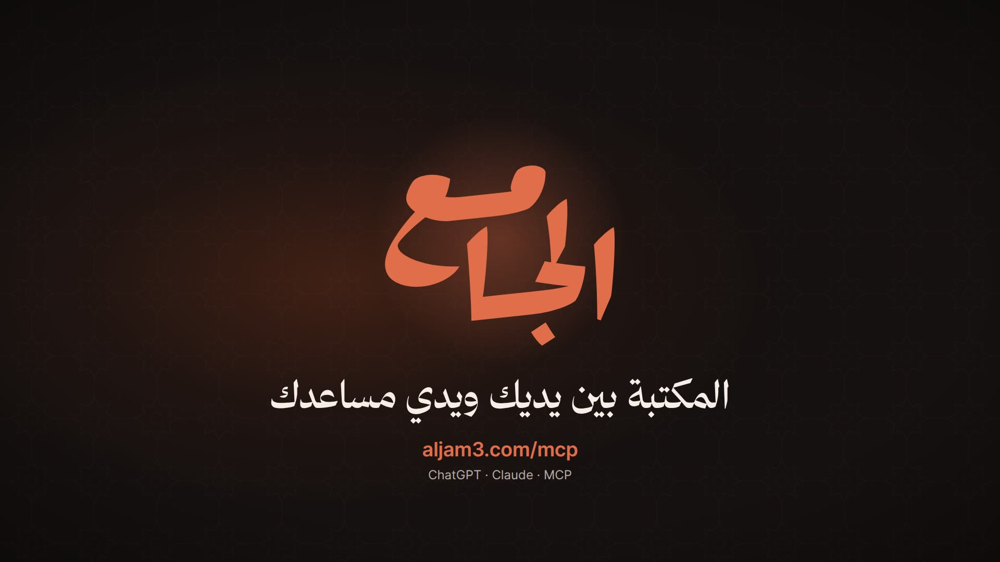
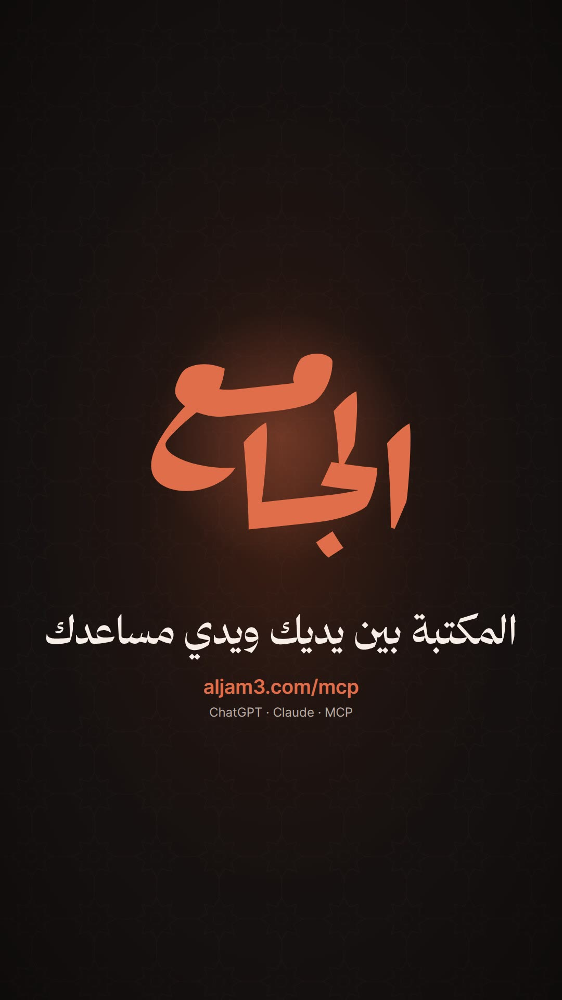

# Aljam3 MCP — launch film

The Arabic launch film for the [Aljam3 public MCP server](https://aljam3.com/mcp), which lets AI assistants
(ChatGPT, Claude and any other MCP client) search Aljam3's books, read pages in context and cite their sources.
It is built with [Remotion](https://www.remotion.dev), runs about one minute, and renders in 16:9 and 9:16 from one
timeline. It follows the pipeline of [aljam3-desktop-launch](https://github.com/ieasybooks/aljam3-desktop-launch).

<p>
  
  
</p>

## What the film shows

Every tool call and result in the demo is real. They are snapshots of the live `https://aljam3.com/mcp` server in
`data/`:

1. The assistant finds *Riyad al-Salihin* by title (`list_books`).
2. It searches the book's text for «إنما الأعمال بالنيات» (`search`).
3. It reads page 29 and the pages around it (`get_page`).
4. It answers with the book, author and page, and a link to the page on aljam3.com.
5. Opening that link shows the real page and its scanned PDF, with the hadith and «متفق على صحته» highlighted.

The assistant window is deliberately generic, not any one product. The screenshots in `public/web/` are of
aljam3.com, captured with headless Chrome.

## Quick start

Requires Node 20+, ffmpeg and Python 3 with [uv](https://docs.astral.sh/uv/).

```sh
npm install
npm run studio                                        # live preview
```

The voice-over and sound effects are committed, so rendering does not need an API key.

## Render

```sh
node scripts/measure.mjs 30                                              # dumps sound events → out/dbg/
python3 scripts/check_choreo.py                                          # clicks, beat order, lag
uv run --with numpy python scripts/mix_audio.py out/final/mix.wav       # soundtrack (offline mix)
npm run render -- McpLaunch-16x9 out/video-16x9.mp4 --muted --crf=17
python3 scripts/finalize.py out/video-16x9.mp4 out/final/aljam3-mcp-launch-16x9.mp4 "الجامع للمساعدات الذكية" out/final/mix.wav
python3 scripts/gen_captions.py                                          # SRT + VTT
```

Use `McpLaunch-9x16` for the vertical version. If Chrome crashes mid-render, point `TMPDIR` at a disk
with more space.

## Layout

| Path | Contents |
| --- | --- |
| `src/ui/chat.tsx` | The assistant window, tool-call steps, answer, source card and browser |
| `src/film/` | Intro, outro, chapter guide, camera and `director.tsx` (cursor, clicks, assistant state) |
| `src/lib/timeline.ts` | Narration timing; everything on screen is cued from spoken words |
| `data/script.json` | Narration script with full tashkeel, voice settings and per-line seeds |
| `data/*.json` | aljam3.com/mcp responses → `scripts/gen_demo_data.py` → `src/data/demo.json` |
| `audio/` | Raw ElevenLabs voice takes and sound effects |
| `public/` | Fonts, icons, brand, aljam3.com screenshots and the prepared audio used by the film |
| `scripts/` | Voice-over, audio, render and QA tools |

## Voice-over

Rebuilding the voice-over needs `ELEVENLABS_API_KEY` in `.env` (see `.env.example`). The narrator is the
ElevenLabs library voice Rawi on `eleven_multilingual_v2`, the same voice as the desktop film.

```sh
python3 scripts/gen_vo.py [clip …]                     # missing (or named) clips → audio/vo/
python3 scripts/takes.py intro3 7 99 2024              # alternative takes with other seeds → archive/takes/
uv run --with numpy python scripts/qa_vo.py            # speech-to-text check against the script
uv run --with numpy python scripts/clean_vo.py         # trim ends and tighten pauses
uv run --with numpy python scripts/prepare_audio.py    # loudness-match → public/audio, src/data/vo.json
uv run --with numpy python scripts/pause_map.py        # pauses and pace per line
uv run --with torch --with transformers python scripts/phonemes.py audio/vo/intro3.mp3   # check case endings
```

Speech-to-text ignores tanween and case endings, so `phonemes.py` checks that they are actually spoken.

## Credits

- Fonts: Noto Naskh Arabic UI, Kitab and Inter (SIL OFL, see `public/fonts/`), plus Thmanyah Serif Display,
  taken from the Aljam3 desktop app.
- Icons: [Lucide](https://lucide.dev) (ISC, see `public/icons/LICENSE`).
- Voice and sound effects: [ElevenLabs](https://elevenlabs.io).
- Book data, page images and screenshots: [aljam3.com](https://aljam3.com).

ChatGPT and Claude are trademarks of their owners. The film names them only as supported MCP clients.

## License

Code is MIT (see [LICENSE](LICENSE)). The Aljam3 name and logo belong to Aljam3. Remotion has
[its own license](https://www.remotion.dev/license).
